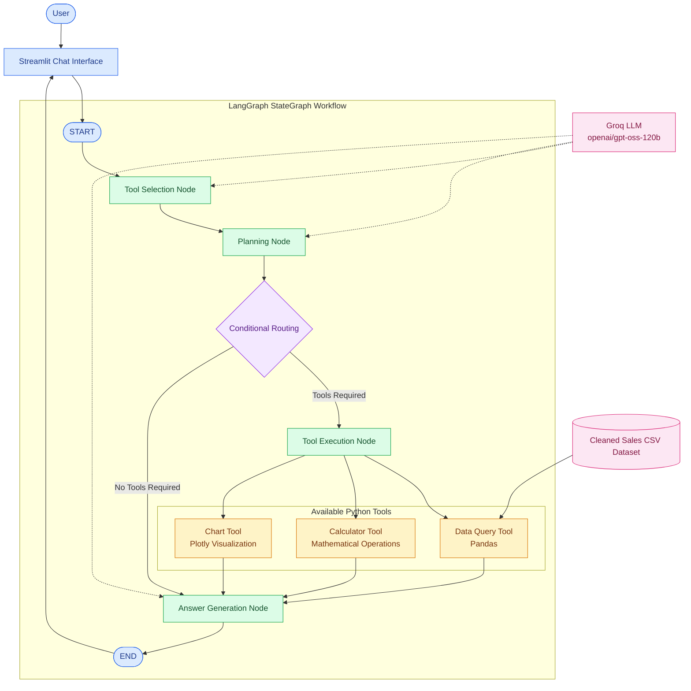

# Insight Copilot – System Architecture

## Architecture Diagram

## Workflow Explanation

1. User enters a natural-language question in Streamlit.
2. Tool Selection Node identifies the required tools.
3. Planning Node generates a short execution plan.
4. Conditional Routing decides whether tool execution is required.
5. Tool Execution Node executes the selected Python tools.
6. Answer Generation Node creates an insight using the tool results.
7. Streamlit displays the final answer and visualization.

## Technology Stack

- Python
- LangGraph StateGraph
- LangChain
- Groq LLM
- Pandas
- Plotly
- Streamlit
